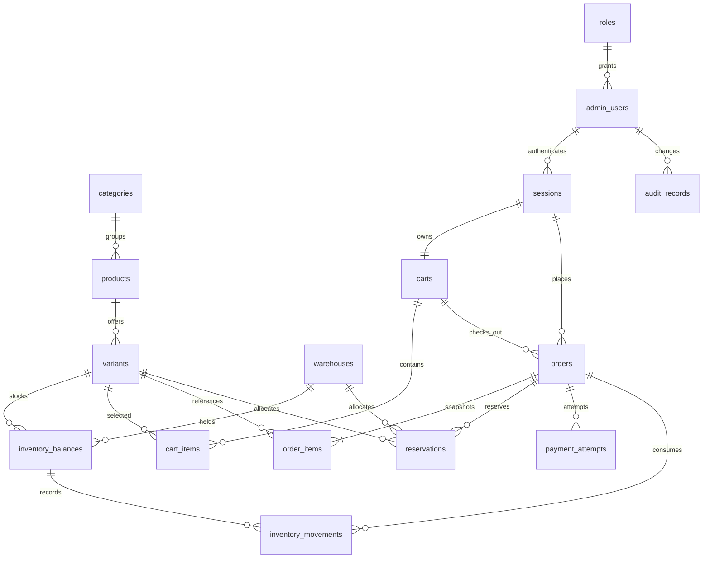

# Transactional data model

The schema is in `api/migrations/001_initial.sql`. `schema_migrations` records applied versions; migrations serialize with a PostgreSQL advisory lock. Seed insertion is repeatable and never resets prices, stock, orders or admin credentials.

## Authorities and deliberate snapshots
- Variant prices are integer **rials**. Go calculates amounts; the browser only formats amounts as tomans (10 rials per toman). There are no taxes, shipping charges or discounts in this demo.
- Inventory balances are the transactional stock authority. On-hand is physical sellable packs, reserved is the subset held by pending orders, available is subtraction. A six-pack is one stock unit of its own SKU.
- Physical stock changes always append a movement in the same transaction. Reservations affect reserved only, so their lifecycle is captured in `reservations`, not physical movements. To reconcile, sum movement deltas by warehouse/SKU and compare against on-hand; sum active reservations and compare against reserved.
- Checkout takes row locks in SKU order and validates active products, current prices and available stock. Cart locks serialize edits/checkouts. A consumed cart is cleared and its revision incremented. Unique cart/revision and session/idempotency-key constraints prevent duplicate orders.
- Orders snapshot product name, SKU, package name, unit price and quantity. These are purchase-time facts, not the current catalog; keeping them is intentional denormalization. `orders.total_rial` is a stored aggregate written alongside immutable lines, with arithmetic checked for overflow.
- Payment locks the order and then modifies its reservations and balances atomically. Duplicate keys with the same scenario are safe; reusing a key with another scenario returns conflict. Success consumes once; cancellation releases once; failure permits retry. The 15-second cleanup loop releases holds after their 15-minute deadline, and payment also checks the deadline synchronously.
- The simulator is deterministic and resolves outside a transaction. Its interface is a seam for a future adapter, not a claim that a real gateway can simply be plugged in: durable initiation, verified callbacks, reconciliation, amount verification and provider idempotency are required for real money.

## Retention and queries
History is retained with restrictive foreign keys; there are no public delete endpoints. Catalog variants can be deactivated and reactivated through the admin catalog. Only cart items cascade when a cart is deleted. Expired sessions retain ownership references to orders; session retention cleanup is deferred rather than deleting business history.

Order lists are bounded (default 20, maximum 100); offset pagination is appropriate to this demo's size. Orders use session/recent and status/recent indexes; active reservation expiry has a partial index. Movement history has warehouse/SKU/recent indexing; primary keys support global recent movement/audit scans. Query plans are inspectable with `scripts/query-plans.sql`; tiny seeded tables reasonably use sequential scans. Large-history keyset pagination is a next step, not necessary infrastructure for this MVP.
